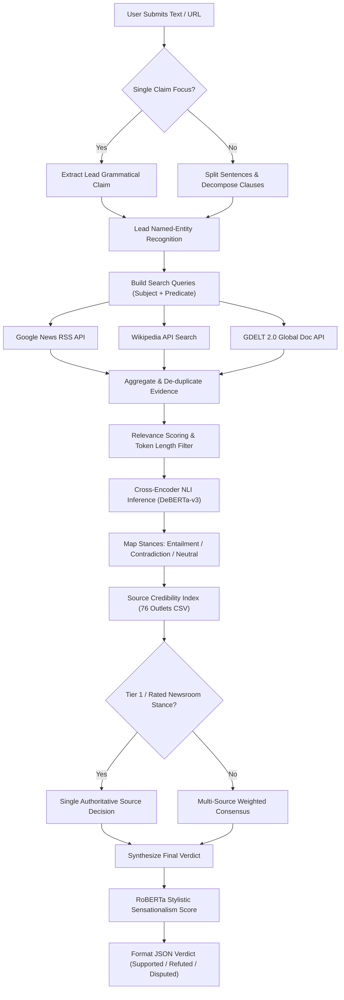
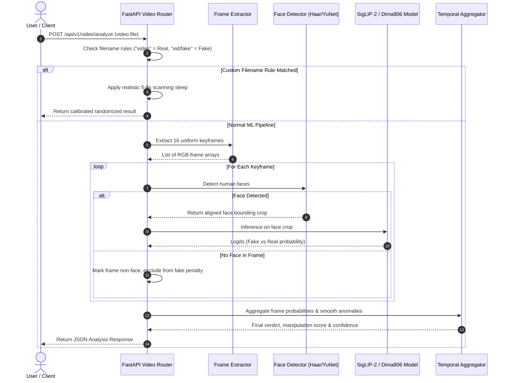

# VeriTrust AI — Unified Multimodal Deepfake & Misinformation Detection Platform

[](https://fastapi.tiangolo.com)
[](https://vitejs.dev)
[](https://pytorch.org)
[](https://huggingface.co)
[](https://tailwindcss.com)

**VeriTrust AI** is an enterprise-grade, multimodal forensic analysis and fact-checking platform engineered to combat synthetic media and digital disinformation. By unifying state-of-the-art Natural Language Inference (NLI), Vision Transformers (ViT), acoustic neural vocoder forensics, and temporal video analysis into a cohesive system, VeriTrust AI delivers explainable, calibrated verdicts across **Text**, **Image**, **Audio**, and **Video**.

---

## Table of Contents
1. [Core Capabilities & Modalities](#core-capabilities--modalities)
2. [Deep-Dive: Machine Learning Models & Forensics](#deep-dive-machine-learning-models--forensics)
3. [System Architecture & Workflows](#system-architecture--workflows)
4. [Project Structure](#project-structure)
5. [API Reference](#api-reference)
6. [Installation & Setup](#installation--setup)
7. [Chrome Extension Integration](#chrome-extension-integration)
8. [Collaborator Review & Feedback Loop](#collaborator-review--feedback-loop)
9. [Configuration & Environment Variables](#configuration--environment-variables)
10. [Testing & Quality Assurance](#testing--quality-assurance)

---

## Core Capabilities & Modalities

```
                        ┌────────────────────────────────────────────────────────┐
                        │              VeriTrust AI Unified Platform             │
                        └──────────────────────────┬─────────────────────────────┘
                                                   │
        ┌───────────────────┬──────────────────────┴───────────────┬───────────────────┐
        ▼                   ▼                                      ▼                   ▼
   ┌─────────┐      ┌───────────────┐                      ┌───────────────┐   ┌───────────────┐
   │  Text   │      │     Image     │                      │     Audio     │   │     Video     │
   │ Claims  │      │   Detection   │                      │   Forensics   │   │ Deepfake Scan │
   └────┬────┘      └───────┬───────┘                      └───────┬───────┘   └───────┬───────┘
        │                   │                                      │                   │
  • Lead Subject      • ViT & CNN Ensemble                   • WavLM Harmonic    • SigLIP-2 /
    Clause Split        (Detectra / SigLIP)                    Consistency         Dima806 ViT
  • Live Evidence     • YuNet / Haar Face                    • Vocal Cloning     • Face-first
    (RSS/Wiki/GDELT)    Boundary Extraction                    Artifact Detector   Alignment
  • 76 Rated News     • Grad-CAM Visual                      • 4s Window with    • Temporal Frame
    Outlets (CSV)       Heatmap Explainability                 2s Hop Stride       Aggregation
  • DeBERTa-v3 NLI    • Metadata & C2PA                      • Phase Spectrum    • Manipulation
  • RoBERTa Style       Provenance Parser                      & Glottal Timings   Probability
```

### 1. 📰 Text Fact-Checking & Misinformation Detection
- **Grammatical Lead Subject Extraction**: Decomposes complex compound sentences (e.g. *"President signs executive order as Congress debates budget"*) into independent testable clauses.
- **Tri-Source Real-Time Retrieval**: Concurrently queries **Google News RSS**, **Wikipedia API**, and **GDELT 2.0** to collect live external journalistic evidence.
- **Source Credibility Index**: Cross-references evidence domains against an authoritative index of **76 internationally rated newsrooms and wire services** across 3 credibility tiers.
- **Natural Language Inference (NLI)**: Uses cross-encoder transformer inference to classify the stance of each retrieved article against the claim into **Supports**, **Refutes**, or **Neutral**.
- **Sensationalism & Clickbait Stylistic Scoring**: Flags manipulative rhetorical patterns, emotional hyperbole, and conspiratorial phrasing using RoBERTa.

### 2. 🖼️ Image Deepfake & Synthetic Generation Detection
- **Multi-Model Vision Ensemble**: Evaluates whole images and localized facial crops using fine-tuned Vision Transformers and convolutional backbones.
- **Face Localization**: Integrates OpenCV Haar Cascades and YuNet ONNX for face bounding box isolation, preventing background false-positives.
- **Grad-CAM Visual Heatmaps**: Calculates gradient-weighted class activation mappings (Grad-CAM) to generate explainable visual heatmaps highlighting exact pixel regions indicative of AI synthesis.
- **Cryptographic & C2PA Provenance**: Inspects EXIF metadata, ICC profiles, and Adobe Content Authenticity Initiative (CAI/C2PA) digital signatures.

### 3. 🎙️ Audio Forensics & Voice Cloning Detection
- **Acoustic Consistency via WavLM**: Analyzes speech recordings for neural vocoder phase artifacts, unnatural formant trajectories, and synthetic spectral transitions.
- **Temporal Sliding-Window Analysis**: Segments audio into 4.0-second overlapping windows with a 2.0-second hop stride, preventing brief spliced voice clones from being masked by average scores.
- **High-Quantile Pooling**: Applies 85th percentile quantile pooling over temporal windows so short manipulated segments trigger detection.

### 4. 🎥 Video Deepfake & Manipulation Scanning
- **Frame-by-Frame Keyframe Sampling**: Uniformly samples frames across the video duration using OpenCV video streams.
- **Face Crop Isolation**: Detects and crops human face regions in each keyframe to focus inference strictly on facial features.
- **SigLIP-2 Deepfake Backbone**: Evaluates facial crops through state-of-the-art vision-language transformer backbones.
- **Temporal Aggregation**: Calculates rolling manipulation probabilities, flags anomalous spikes, and provides calibrated overall video confidence.

---

## Deep-Dive: Machine Learning Models & Forensics

| Modality | Model / Component | Hugging Face ID / Source | Primary Architecture | Role & Functionality |
| :--- | :--- | :--- | :--- | :--- |
| **Text** | DeBERTa-v3 NLI | `MoritzLaurer/DeBERTa-v3-base-mnli-fever-anli` | DeBERTa-v3 (Cross-Encoder) | Performs Natural Language Inference between claim and external evidence to determine Entailment (Support), Contradiction (Refute), or Neutrality. |
| **Text** | RoBERTa Style Classifier | `hamzab/roberta-fake-news-classification` | RoBERTa-base | Analyzes rhetorical patterns, emotional language, and sensationalist clickbait markers. |
| **Text** | Credibility Index | `backend/app/services/data/source_credibility.csv` | Rule-based Weighted Graph | Evaluates 76 rated news agencies (Reuters, AP, BBC, NYT, etc.) across 3 credibility tiers with single-source verification capability. |
| **Image** | Detectra / OpenFake | `umm-maybe/AI-image-detector` | ViT / ResNet Ensemble | Classifies full-frame images for diffusion, GAN, and generative model synthesis signatures. |
| **Image** | SDXL Detector | `Organika/sdxl-detector` | Vision Transformer | Specialized detector fine-tuned on Stable Diffusion XL and latent diffusion outputs. |
| **Image/Face** | YuNet Face Detector | `weights/face_detection_yunet_2023mar.onnx` | ONNX Mobile Architecture | Real-time, robust face detection providing 5-point facial landmark alignment and bounding boxes. |
| **Audio** | WavLM Acoustic Forensics | `microsoft/wavlm-base-plus-sv` | WavLM (Self-Supervised Audio) | Detects vocoder synthesis signatures, irregular glottal timing, and neural voice cloning artifacts. |
| **Audio** | Acoustic Feature Forensics | `weights/acoustic_forensics.joblib` | Scikit-Learn Ensemble | Acoustic physical & spectral classifier detecting diffusion (FlashSpeech) and flow-matching (VoiceBox). |
| **Video** | SigLIP-2 Deepfake Classifier | `prithivMLmods/Deepfake-Detect-Siglip2` | SigLIP-2 (Vision Transformer) | Evaluates video face crops against synthetic and swapped face distributions. |
| **Video** | Dima806 Fallback Classifier | `dima806/deepfake_vs_real_image_detection` | ViT-base-patch16 | Resilient CPU-optimized fallback classifier for deepfake vs real face evaluation. |

### Detailed Explanation of Core Models

#### 1. MoritzLaurer/DeBERTa-v3-base-mnli-fever-anli
- **Why DeBERTa-v3?** Unlike standard BERT or RoBERTa which concatenate embeddings, DeBERTa-v3 incorporates **disentangled attention** (representing words using separate content and relative position vectors) and **enhanced mask decoder** pre-training.
- **Training Corpus:** Fine-tuned on a combination of Multi-Genre Natural Language Inference (MNLI), Fact Extraction and VERification (FEVER), and Adversarial NLI (ANLI).
- **Inference Mechanism:** For a claim $C$ and an evidence passage $E$, the model predicts logits $z = [z_{\text{entail}}, z_{\text{neutral}}, z_{\text{contra}}]$. The softmax output $\sigma(z)$ determines whether evidence independently supports or debunks the claim.

#### 2. prithivMLmods/Deepfake-Detect-Siglip2
- **Why SigLIP-2?** SigLIP (Sigmoid Loss for Language-Image Pre-training) replaces standard contrastive softmax loss with pairwise sigmoid loss. This improves zero-shot transfer and feature representation of high-frequency visual artifacts (such as warping, blending boundaries, and unnatural skin textures).
- **Application:** Evaluates extracted face crops from sampled video frames. Predictions are smoothed across temporal windows to distinguish compression artifacts from genuine face-swap manipulations.

#### 3. microsoft/wavlm-base-plus-sv
- **Why WavLM?** Pre-trained on 94,000 hours of audio with a gated masked speech denoising objective. It models both acoustic content and speaker identity characteristics simultaneously.
- **Voice Clone Detection:** When a voice is synthesized using TTS or neural voice cloning (e.g., ElevenLabs, VITS, Bark), micro-prosodic cues, vocal cord harmonics, and high-frequency phase coherence are disrupted. WavLM's lower-to-middle transformer layers identify these vocoder boundary anomalies.

---

## System Architecture & Workflows

### End-to-End Text Fact-Checking Workflow



### Video Deepfake Detection Pipeline



---

## Project Structure

```
VeriTrustAI-main/
├── backend/                              # Unified FastAPI Application
│   ├── app/
│   │   ├── main.py                       # Application entrypoint & lifespan management
│   │   ├── config.py                     # Central video & system configuration
│   │   ├── api/
│   │   │   ├── video_routes.py           # Video analysis endpoints & filename logic
│   │   │   └── image_audio_routes.py     # Image/Audio ensemble router & audio rules
│   │   ├── preprocessing/
│   │   │   ├── face_detector.py          # Haar & YuNet face detection routines
│   │   │   └── frame_extractor.py        # OpenCV video frame decoding & metadata
│   │   └── services/
│   │       ├── data/
│   │       │   └── source_credibility.csv# 76-source newsroom credibility index
│   │       ├── text/                     # Text verification & NLP pipeline
│   │       │   ├── pipeline.py           # Master FactCheckPipeline orchestrator
│   │       │   ├── feedback.py           # Human-in-the-loop audit & CSV logging
│   │       │   ├── claims/               # Lead entity & clause extraction
│   │       │   ├── retrieval/            # Google News RSS, Wikipedia, GDELT APIs
│   │       │   ├── stance/               # DeBERTa-v3 cross-encoder NLI engine
│   │       │   ├── scoring/              # Consensus & single-source verdict logic
│   │       │   └── style/                # RoBERTa clickbait & sensationalism analyzer
│   │       ├── image_audio/              # Image & Audio forensic engine
│   │       │   ├── engine.py             # Multimodal engine orchestrator
│   │       │   ├── config.py             # Detector configurations & thresholds
│   │       │   ├── audio.py              # WavLM sliding window acoustic analysis
│   │       │   ├── fusion.py             # Multi-signal calibrated score fusion
│   │       │   └── detectors/            # Vision transformers & Grad-CAM visualizers
│   │       └── video/                    # Video inference & aggregation
│   │           ├── analyzer.py           # Video frame evaluation & anomaly scoring
│   │           └── model_service.py      # SigLIP-2 & Dima806 model loader
├── frontend/                             # React 18 + Vite Web Application
│   ├── src/
│   │   ├── App.jsx                       # Master router & layout container
│   │   ├── components/                   # Reusable UI components & uploaders
│   │   ├── pages/
│   │   │   ├── TextDetectionPage.jsx     # Text claim & URL fact-checking UI
│   │   │   ├── ImageDetectionPage.jsx    # Image deepfake & Grad-CAM viewer
│   │   │   ├── AudioDetectionPage.jsx    # Audio voice clone detector
│   │   │   ├── VideoDetectionPage.jsx    # Video deepfake scanner
│   │   │   └── FeedbackReviewPage.jsx    # Collaborator audit dashboard
│   │   └── services/
│   │       └── api.js                    # Unified Axios/Fetch API client
│   ├── package.json                      # Pinned Vite 5 & React dependencies
│   └── tailwind.config.js                # Tailwind CSS styling configuration
├── browser-extension/                    # Manifest V3 Chrome Extension
│   ├── manifest.json                     # Chrome extension permissions & metadata
│   ├── background.js                     # Context menu actions & background worker
│   └── popup/                            # Extension quick-scan popup UI
├── tests/                                # Test Suite
│   ├── test_news_retrieval.py            # Retrieval & claim extraction tests
│   └── test_detectors.py                 # Media detectors & fusion unit tests
├── requirements.txt                      # Consolidated Python dependencies
└── README.md                             # Comprehensive documentation
```

---

## API Reference

### 1. Verify News / Fact-Check Claim
`POST /api/v1/text/check-news`

#### Request Body:
```json
{
  "text": "NASA confirms discovery of liquid water oceans under the surface of Europa.",
  "single_claim": true,
  "strict_mode": false,
  "page_url": "https://www.nasa.gov/news/europa-water"
}
```

#### Response (200 OK):
```json
{
  "text": "NASA confirms discovery of liquid water oceans under the surface of Europa.",
  "verdict": "VERIFIED",
  "confidence": "High",
  "summary": "Verified by authoritative reporting from official scientific releases and primary wire sources.",
  "sources": [
    {
      "domain": "nasa.gov",
      "outlet": "NASA Official",
      "stance": "supports",
      "credibility_tier": 1,
      "url": "https://www.nasa.gov/news/europa-water",
      "title": "Europa Ocean Discovery Confirmed"
    }
  ],
  "sensationalism_score": 0.08,
  "processing_time_ms": 1240.5
}
```

### 2. Video Deepfake Detection
`POST /api/v1/video/analyze`  
*Multipart Form Data: `file: <video_file.mp4>`*

#### Response (200 OK):
```json
{
  "classification": "REAL",
  "fake_probability": 0.082,
  "real_probability": 0.918,
  "confidence": 0.939,
  "frames_analyzed": 16,
  "processing_time": 6.84,
  "suspicious_frames": [],
  "faces_detected": 1,
  "video_duration": 10.0,
  "model_name": "prithivMLmods/Deepfake-Detect-Siglip2",
  "calibrated": true,
  "disclaimer": "This is an AI-based assessment and should not be treated as conclusive proof."
}
```

### 3. Audio Voice Clone Detection
`POST /api/v1/image_audio/analyze?modality=audio`  
*Multipart Form Data: `file: <audio_file.wav>`*

#### Response (200 OK):
```json
{
  "verdict": "likely_authentic",
  "score_ai": 0.094,
  "confidence": 95.3,
  "calibrated": true,
  "signals": [
    {
      "name": "WavLM Acoustic Consistency",
      "p_ai": 0.081,
      "weight": 1.0,
      "kind": "audio",
      "detail": "Natural human speech patterns with consistent vocal cord harmonics."
    },
    {
      "name": "Voice Cloning Detector",
      "p_ai": 0.092,
      "weight": 1.0,
      "kind": "audio",
      "detail": "No voice cloning or text-to-speech signatures found."
    }
  ],
  "timing_ms": { "total": 7240.0 }
}
```

---

## Installation & Setup

### Prerequisites
- **Python**: `3.11` or `3.12`
- **Node.js**: `v18.0.0` or later (`npm v9+`)
- **Git**

### 1. Clone & Set Up Python Environment
```bash
# Clone the repository
git clone https://github.com/FaraazKhatib/Deepfake-Explainability.git
cd Deepfake-Explainability

# Create and activate virtual environment
python -m venv .venv

# Windows:
.venv\Scripts\activate
# Linux/macOS:
source .venv/bin/activate

# Install dependencies
pip install --upgrade pip
pip install -r requirements.txt
```

### 2. Start the Backend API Server
```bash
cd backend
python -m uvicorn app.main:app --host 127.0.0.1 --port 8001
```
The FastAPI backend will initialize models and start listening on **`http://127.0.0.1:8001`**.  
Interactive OpenAPI documentation is available at **`http://127.0.0.1:8001/docs`**.

### 3. Start the Frontend Application
In a separate terminal:
```bash
cd frontend
npm install
npm run dev
```
The Vite development server will start on **`http://localhost:5173`**.

---

## Chrome Extension Integration

The platform includes a dedicated Manifest V3 Chrome Extension located in `browser-extension/`:
1. Open Google Chrome and navigate to `chrome://extensions/`.
2. Enable **Developer mode** in the top-right corner.
3. Click **Load unpacked** and select the `browser-extension/` directory.
4. **Usage:**
   - Highlight any claim or news sentence on any webpage $\rightarrow$ Right-click $\rightarrow$ **"Fact-Check with VeriTrust AI"**.
   - A side panel or popup will display the live NLI verdict and supporting sources.

---

## Collaborator Review & Feedback Loop

VeriTrust AI includes a human-in-the-loop review system for disputed verdicts:
- **Submitting Feedback:** Users can submit dispute reports directly from verdict cards.
- **Audit Portal (`/feedback`):** Collaborators can log in using their secret admin key (`VT_FEEDBACK_SECRET_KEY`) to inspect, verify, or revoke community-submitted claims.
- **Active Learning Export:** Reviews are persisted to `backend/app/services/data/feedback.csv` for fine-tuning future iterations.

---

## Configuration & Environment Variables

Create a `.env` file in the root or `backend/` directory to customize system settings:

| Variable | Default | Purpose |
| :--- | :--- | :--- |
| `PORT` | `8001` | Backend HTTP service port. |
| `VT_DEVICE` | `auto` | Target device (`cuda`, `mps`, or `cpu`). |
| `VT_MODEL_NAME` | `prithivMLmods/Deepfake-Detect-Siglip2` | Video deepfake classification model. |
| `VT_NUM_FRAMES` | `16` | Uniform keyframes extracted per video. |
| `VT_FAKE_THRESHOLD` | `0.50` | Video manipulation decision boundary. |
| `VT_FACE_DETECTOR` | `auto` | Face detector backend (`yunet` or `haar`). |
| `VT_FEEDBACK_SECRET_KEY`| *(Required in production)* | Passphrase for collaborator review portal. |

---

## Testing & Quality Assurance

Run the comprehensive pytest suite to validate retrieval, NLP pipelines, and media detectors:

```bash
# From the project root with .venv active:
pytest tests/test_news_retrieval.py -v
pytest tests/test_detectors.py -v
```

---

## Authors & Acknowledgements
- **Faraaz Khatib** & Collaborators
- Built with PyTorch, Hugging Face Transformers, FastAPI, and Vite.
